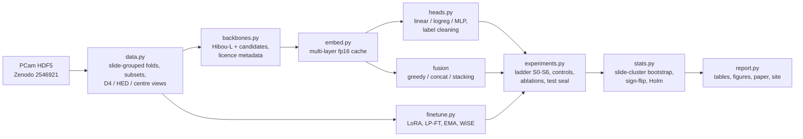

# Better cancer classification: hill-climbing Hibou-L on PatchCamelyon

This project takes **Hibou-L** ([Nechaev et al. 2024](https://arxiv.org/abs/2406.05074), [weights](https://huggingface.co/histai/hibou-L)), the pathology foundation model with the best published score on the official **PatchCamelyon (PCam)** lymph-node metastasis test split, and tries to improve it one pre-registered step at a time.
- **The model:** a DINOv2 ViT-L/14 with 4 registers and 304M parameters, Apache-2.0.
- **The starting point:** 0.955 balanced accuracy (BA) on the [kaiko eva](https://github.com/kaiko-ai/eva) leaderboard, using a frozen backbone and a linear head.
- **The improvements come from neighbouring work:**
  - Intermediate-layer and centre-region features.
  - Test-time rotations and flips.
  - Out-of-fold label cleaning, as in PANDA's 1st place.
  - Fusion and stacking with other foundation models.
  - LoRA fine-tuning with LP-FT, stain augmentation and WiSE-style weight interpolation.
- **How steps are chosen:** on slide-grouped cross-validation over training slides, then gated on the validation split. The test split stays **sealed** until the whole procedure is frozen.

> **Status: pre-registered, no results yet.** Hypotheses, metrics, analysis plan and falsification criteria are fixed in [`reports/preregistration.md`](reports/preregistration.md), pushed before any data was loaded. This README will gain results tables, figures and a link to the interactive explorer as the stages finish.

## Why
- **The task.** Finding metastases in sentinel lymph nodes is a routine, labour-intensive step in breast-cancer staging ([Camelyon16](https://jamanetwork.com/journals/jama/fullarticle/2665774)). PCam turns it into a binary patch task: a patch is positive if the centre 32×32 px of the 96×96 px patch contains tumour.
- **The gap.** Pathology foundation models used as frozen feature extractors cluster at 0.93–0.955 BA on PCam. Fine-tuning, multi-layer features, model fusion and Kaggle-style data engineering are each reported to help elsewhere. Their effect on the strongest model is not known.
- **The approach.** Measure each of them with honest statistics: slide-level resampling, a sealed test, matched controls and an out-of-distribution hospital check.

## Method in brief
1. **Reproduce the baseline:** the eva protocol for Hibou-L (CLS embedding + linear head, 5 seeds). The gate requires validation BA 0.939 ± 0.01 and embeddings that match eva's.
2. **Climb a fixed ladder** of pre-specified candidates:

   | Step | Candidates | Origin of the idea |
   |---|---|---|
   | S1 representation | last-layer CLS, CLS+mean, last-4-layer (DINOv2 protocol), spread layers, centre-token pooling, centre-crop view | [DINOv2 linear eval](https://github.com/facebookresearch/dinov2), [multi-layer probing](https://arxiv.org/abs/2601.09322), PCam label rule |
   | S2 head | linear (eva), logistic regression, MLP | UNI / Virchow2 / UBC-OCEAN probes |
   | S3 test-time augmentation | average over 8 rotations/flips | Kaggle HCD solutions |
   | S3b label cleaning | drop confidently-wrong out-of-fold training labels | PANDA 1st place |
   | S4 fusion | greedy ensemble, concatenation, stacking with Prov-GigaPath, H-optimus-0, Virchow2, Virchow, Hibou-B, Midnight-12k, … | ISIC 2024 stacking, [Caruana 2004](https://www.cs.cornell.edu/~caruana/ctp/ct.papers/caruana.icml04.icdm06long.pdf) |
   | S5 LoRA | all blocks; head initialised from the probe (LP-FT); D4 + HED stain augmentation; EMA | [Lee 2024](https://arxiv.org/abs/2410.16038), [LP-FT](https://arxiv.org/abs/2202.10054), [WILDS](https://wilds.stanford.edu/leaderboard/) |
   | S5b weight space | LoRA scaling α (WiSE-FT), model soup | [WiSE-FT](https://arxiv.org/abs/2109.01903), [soups](https://arxiv.org/abs/2203.05482) |

3. **Freeze, then score once.** Freeze and git-tag the ladder, then score every arm once on the sealed test split: baselines, controls, the final pipeline and ablations. Also score them on the held-out Camelyon17-WILDS hospitals.
4. **Statistics:** stratified slide-cluster bootstrap BCa CIs, per-slide sign-flip tests and Holm correction.

## Pre-registered hypotheses (summary)
| ID | Claim tested on the sealed test split |
|---|---|
| H1 | The final pipeline beats the reproduced Hibou-L baseline by ≥ 0.5 pt BA |
| H1b | …and beats the best single other foundation model, so the gain is not a backbone swap |
| H4 | LoRA beats a frozen head trained on the same images with the same augmentation |
| H6 | The gain transfers to Camelyon17-WILDS hospitals that Camelyon16 did not use |

**Controls:**
- shuffled labels
- majority class
- colour-histogram logistic regression
- random-init ViT-L
- DINOv2 ViT-L trained on natural images

## Architecture


## Setup
Requirements:
- Windows, Linux or WSL with Python 3.12 via [uv](https://docs.astral.sh/uv/).
- An NVIDIA GPU. Developed on an RTX 5070 Laptop: 8 GB, Blackwell, CUDA 12.8 wheels.
- About 60 GB of disk for data, model weights and embedding caches.

```bash
git clone https://github.com/BurnyCoder/better-cancer-classification-with-machine-learning
cd better-cancer-classification-with-machine-learning
cp .env.example .env    # point DATA_DIR / EMB_DIR / HF_HUB_CACHE at a large disk
uv sync
uv run pytest
```

**Model access.** Several backbones require accepting their licence on their Hugging Face page while logged in (`hf auth login`):
- Hibou-L/B
- H-optimus-0
- Prov-GigaPath
- Virchow / Virchow2

The pipeline checks access and uses only the models you can load. See [`reports/preregistration.md` §9](reports/preregistration.md).

## Usage
The CLI is being implemented. Planned interface:

```bash
uv run python main.py download     # PCam from Zenodo, md5-verified
uv run python main.py verify       # leakage checks: slide-disjoint splits, duplicate hashes
uv run python main.py all          # every stage in order (test stays sealed)
uv run python main.py report       # regenerate every table and figure from results/*.json
```

## Data, models and licences
- **PCam:** CC0 ([README](https://github.com/basveeling/pcam)), downloaded from [Zenodo 2546921](https://zenodo.org/records/2546921).
  - The GitHub README lists the md5 sums of `valid_x` and `test_x` swapped. The Zenodo API checksums are authoritative and are used here.
- **Camelyon17-WILDS:** CC0 ([WILDS](https://wilds.stanford.edu/datasets/)).
- **Models used under their licences:**
  - Hibou-L/B, H-optimus-0, Prov-GigaPath, Virchow, OpenMidnight-1.1 and DINOv2: Apache-2.0.
  - Midnight-12k: MIT.
  - Virchow2: CC-BY-NC-ND-4.0.
  - Phikon / Phikon-v2: Owkin non-commercial.
- **Publishing rules:** only artifacts derived from permissively licensed models are published. Non-commercial or no-derivatives models contribute aggregate metrics only.
- **No clinical use:** this is research code, not a medical device.

## Repository layout
```
main.py              CLI wrapper calling each phase
src/pcam_hc/         data, backbones, embedding cache, heads, LoRA, metrics, statistics, experiments, reporting
tests/               pytest suite (TDD)
reports/             pre-registration, per-experiment reports, summary, paper
docs/                usage, design notes, licences
site/                GitHub Pages explorer
```
