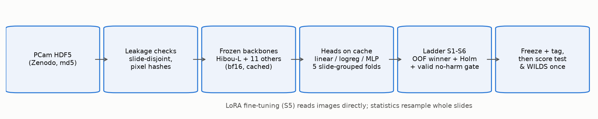
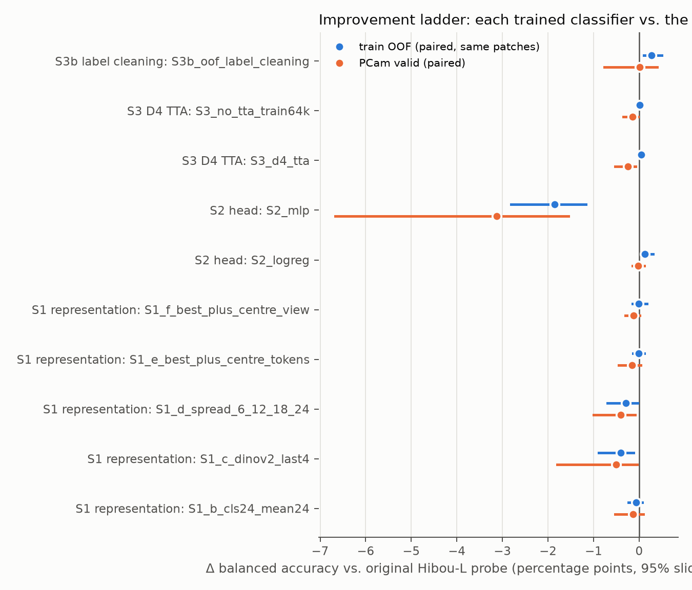
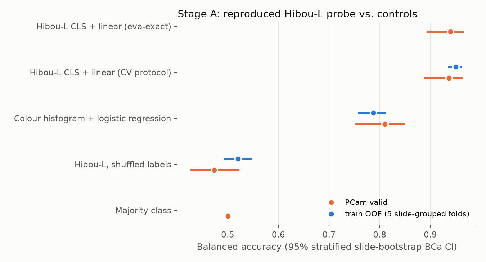
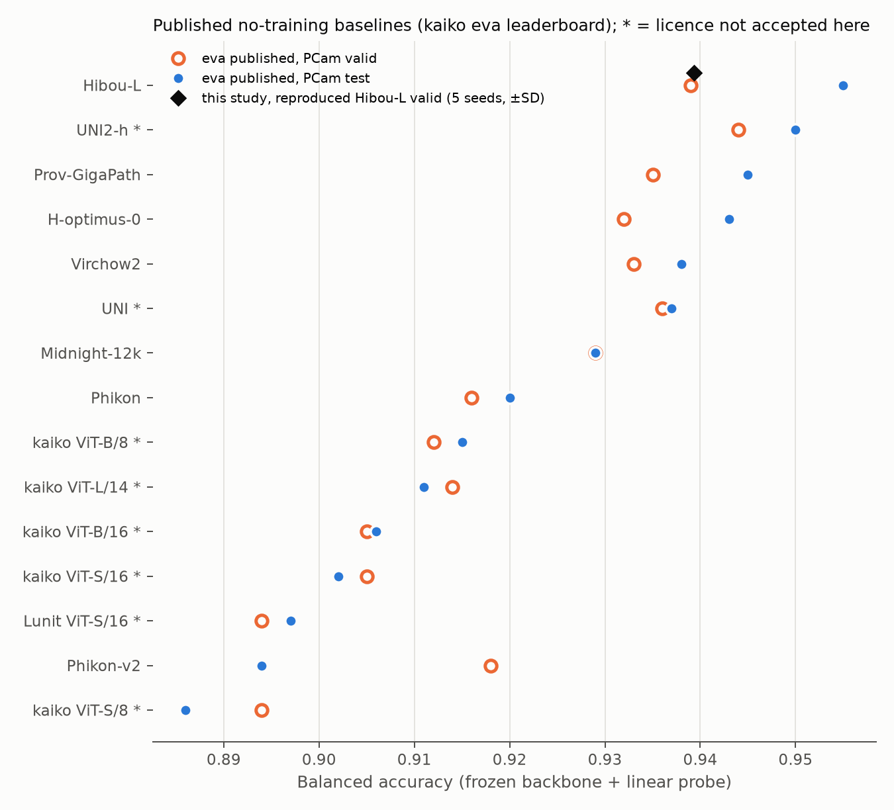
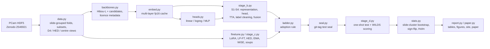

# Better cancer classification: hill-climbing Hibou-L on PatchCamelyon

This project takes **Hibou-L** ([Nechaev et al. 2024](https://arxiv.org/abs/2406.05074), [weights](https://huggingface.co/histai/hibou-L)), the pathology foundation model with the best published score on the official **PatchCamelyon (PCam)** lymph-node metastasis test split, and tries to make it more accurate. Every change is pre-registered and tested one step at a time.

**How it works:**
- **The model.** Hibou-L is a DINOv2 ViT-L/14 with 304M parameters, pretrained without labels on about 1M private slides.
- **Features.** We turn every PCam patch into Hibou-L embeddings, train small classifier heads on them, and then try ideas transferred from neighbouring work:
  - features from intermediate layers and from the patch centre ([DINOv2 linear eval](https://github.com/facebookresearch/dinov2), [multi-layer probing](https://arxiv.org/abs/2601.09322));
  - averaging predictions over rotations and flips, from Kaggle cancer-detection solutions ([write-up](https://arxiv.org/abs/1906.09587));
  - removing likely mislabelled training patches, as in PANDA 1st place ([code](https://github.com/kentaroy47/Kaggle-PANDA-1st-place-solution));
  - fusing several foundation models;
  - LoRA fine-tuning ([Hu 2021](https://arxiv.org/abs/2106.09685), [Lee 2024](https://arxiv.org/abs/2410.16038)) with LP-FT ([Kumar 2022](https://arxiv.org/abs/2202.10054)), stain augmentation ([Tellez 2019](https://arxiv.org/abs/1902.06543)) and weight averaging ([WiSE-FT](https://arxiv.org/abs/2109.01903), [soups](https://arxiv.org/abs/2203.05482)).
- **Selection.** Each idea is kept only if it wins on cross-validation over training *slides* and does not hurt on the validation split.
- **Sealed test.** The official test split is locked in code until the whole procedure is frozen, and is then scored once.

**Why.** Finding metastases in sentinel lymph nodes is a routine, labour-intensive step in breast-cancer staging ([Camelyon16](https://jamanetwork.com/journals/jama/fullarticle/2665774)). Foundation models are usually compared with a frozen backbone and a linear probe ([kaiko eva leaderboard](https://github.com/kaiko-ai/eva)). Whether the many adaptation tricks reported elsewhere still help on top of the strongest model is unknown. Measuring that honestly needs slide-level statistics, because patches from one slide are correlated. It also needs a test split that nobody can tune on.



## Highlights (release 1)
<!-- HIGHLIGHTS:START -->
- ✅ **Exact reproduction.** Our Hibou-L probe scores **0.9394 ± 0.0007** validation balanced accuracy (BA; 5 seeds), against the published **0.939** ([eva](https://github.com/kaiko-ai/eva)). Our remote-code-free model matches Hibou's own code to a cosine of 1.000000.
- ✅ **Incumbent under cross-validation** over 216 training slides: OOF BA 0.950 (95% CI 0.937–0.960); validation 0.937 (95% CI 0.889–0.962).
- ✅ **Controls behave as expected.** Shuffled labels: 0.520 (chance). Colour histogram only: 0.787 (95% CI 0.758–0.811). Colour carries signal, but far less than Hibou-L.
- ⏳ **Improvement ladder (release 2, in progress).** 10 classifier(s) trained on frozen Hibou-L features so far. The best paired out-of-fold difference from the original is +0.27 pt BA (95% CI +0.10 to +0.50; `S3b_oof_label_cleaning`). Steps decided: 4; adopted: 1.
- ⚠️ **Data leak found in PCam.** 33 distinct test images are pixel-identical to train images. All come from test slide `camelyon16_test_049` and train slide `camelyon16_train_tumor_036`, at identical slide coordinates, which indicates a duplicate scan. CAMELYON16 notes list test_049 as a duplicate slide removed from the official release, but it is still in PCam. Every test result will also be reported without it (decided while test was sealed).
- ⚠️ **Validation split is small.** It has 54 slides, 22 with tumour, so its CIs are 3.1× wider than the train CV ones. Ideas are therefore selected on train CV, and validation only checks that nothing gets worse.
- ⚠️ **The official Camelyon17-WILDS test hospital is not out-of-distribution for PCam.** Its colour signature matches UMCU, a Camelyon16 source hospital (L1 0.69 vs. 1.68 to RUMC). Our out-of-hospital check therefore uses CWZ, RST and LPON.
- **Data:** train 262,144 / valid 32,768 / test 32,768 patches from 216 / 54 / 129 slides; no slide is shared between splits.
<!-- HIGHLIGHTS:END -->

**Release status:**
- **Release 1:** the reproduced model, its controls and the no-training baselines. Published with the [paper (PDF)](reports/paper/paper.pdf), [reports](reports/experiments_summary.md), the [interactive explorer](https://burnycoder.github.io/better-cancer-classification-with-machine-learning/) and the [Hugging Face collection](https://huggingface.co/collections/BurnyCoder/pcam-hill-climbing-of-hibou-l-6ae69845aceb3bbab4777782).
- **Release order** (each release is pushed with an updated paper, reports, README, site and Hugging Face):
  1. ✅ Reproduced Hibou-L with cheap controls and no-training baselines.
  2. ⏳ *Training now:* the **Hibou-L-only improvement** ladder (S1 representation, S2 head, S3 rotation/flip averaging, S3b label cleaning, S5 LoRA, S5b weight averaging), compared with the original Hibou-L, the cheap controls and the published baselines.
  3. Control models: DINOv2-L with natural-image weights, randomly initialised ViT-L, and the augmentation-matched frozen control (H4).
- **Postponed to a later day:**
  - baseline models: the 9 other foundation models (B\*) and ConvNeXt-T;
  - ablations, including those that need no training;
  - S4 fusion and the S6 final combination;
  - the seed/hyperparameter sensitivity study.
- **Test split:** stays sealed until the whole ladder (through S6) is frozen.
- **Plan of record:** every hypothesis and decision rule is fixed in the [pre-registration](reports/preregistration.md), which was pushed before any data was loaded.

## Results
Every number below is generated by `uv run python main.py report` from `results/*.json`. The test split is still **sealed**, so all results are on train cross-validation (OOF = out-of-fold) and on the validation split.

<!-- RESULTS:START -->
H2 reproduction gate: valid BA 0.9394 ± 0.0007 (5 seeds) vs. eva's published 0.939 ± 0.010 → **pass**.

| Arm | Backbone(s) | Head | Dim | OOF BA [95% CI] | Valid BA [95% CI] | Valid BA seed SD | Valid AUROC | Publishable |
|---|---|---|---|---|---|---|---|---|
| `control_color_histogram` | — | logreg | 96 | 0.7870 [0.7580, 0.8106] | 0.8098 [0.7530, 0.8472] | 0.0000 | 0.8923 | yes |
| `control_majority` | — | — | — | — | 0.5000 [0.5000, 0.5000] | 0.0000 | 0.5000 | yes |
| `control_shuffled_labels` | Hibou-L | linear | 1024 | 0.5204 [0.4935, 0.5457] | 0.4731 [0.4280, 0.5212] | 0.0471 | 0.4637 | yes |
| `S0_eva_exact_hibou_l` | Hibou-L | linear | 1024 | — | 0.9396 [0.8936, 0.9638] | 0.0007 | 0.9833 | yes |
| `S0_hibou_l_cls_linear` | Hibou-L | linear | 1024 | 0.9498 [0.9366, 0.9600] | 0.9367 [0.8888, 0.9617] | 0.0015 | 0.9823 | yes |
| `S1_b_cls24_mean24` | Hibou-L | linear | 2048 | 0.9491 [0.9353, 0.9598] | 0.9353 [0.8830, 0.9607] | 0.0019 | 0.9816 | yes |
| `S1_c_dinov2_last4` | Hibou-L | linear | 5120 | 0.9457 [0.9303, 0.9573] | 0.9316 [0.8712, 0.9593] | 0.0025 | 0.9796 | yes |
| `S1_d_spread_6_12_18_24` | Hibou-L | linear | 8192 | 0.9469 [0.9318, 0.9585] | 0.9326 [0.8786, 0.9594] | 0.0020 | 0.9787 | yes |
| `S1_e_best_plus_centre_tokens` | Hibou-L | linear | 2048 | 0.9496 [0.9361, 0.9599] | 0.9352 [0.8839, 0.9608] | 0.0017 | 0.9817 | yes |
| `S1_f_best_plus_centre_view` | Hibou-L | linear | 2048 | 0.9497 [0.9362, 0.9599] | 0.9354 [0.8889, 0.9609] | 0.0000 | 0.9818 | yes |
| `S2_logreg` | Hibou-L | logreg | 1024 | 0.9510 [0.9378, 0.9610] | 0.9365 [0.8886, 0.9618] | 0.0000 | 0.9827 | yes |
| `S2_mlp` | Hibou-L | mlp | 1024 | 0.9312 [0.9112, 0.9462] | 0.9054 [0.8227, 0.9423] | 0.0000 | 0.9741 | yes |
| `S3_d4_tta` | Hibou-L | linear | 1024 | 0.9522 [0.9396, 0.9617] | 0.9343 [0.8836, 0.9604] | 0.0000 | 0.9823 | yes |
| `S3_no_tta_train64k` | Hibou-L | linear | 1024 | 0.9517 [0.9391, 0.9615] | 0.9352 [0.8854, 0.9612] | 0.0000 | 0.9822 | yes |
| `S3b_oof_label_cleaning` | Hibou-L | linear | 1024 | 0.9525 [0.9394, 0.9624] | 0.9368 [0.8908, 0.9636] | 0.0000 | 0.9833 | yes |

**Improvement ladder: every trained classifier vs. the original Hibou-L probe** (paired on the same patches; per-candidate p-values are descriptive, and adoption uses the pre-registered Holm + valid-gate rule):

| Step | Classifier | OOF BA [95% CI] | Δ OOF vs original [95% CI] | sign-flip p | Valid BA | Δ valid vs original |
|---|---|---|---|---|---|---|
| S1 representation | `S1_b_cls24_mean24` | 0.9491 [0.9353, 0.9598] | -0.07 pt [-0.24, +0.06] | 0.426 | 0.9353 | -0.14 pt |
| S1 representation | `S1_c_dinov2_last4` | 0.9457 [0.9303, 0.9573] | -0.40 pt [-0.89, -0.12] | 0.0284 | 0.9316 | -0.51 pt |
| S1 representation | `S1_d_spread_6_12_18_24` | 0.9469 [0.9318, 0.9585] | -0.29 pt [-0.69, -0.04] | 0.0931 | 0.9326 | -0.41 pt |
| S1 representation | `S1_e_best_plus_centre_tokens` | 0.9496 [0.9361, 0.9599] | -0.01 pt [-0.14, +0.11] | 0.826 | 0.9352 | -0.15 pt |
| S1 representation | `S1_f_best_plus_centre_view` | 0.9497 [0.9362, 0.9599] | -0.01 pt [-0.15, +0.17] | 0.944 | 0.9354 | -0.13 pt |
| S2 head | `S2_logreg` | 0.9510 [0.9378, 0.9610] | +0.12 pt [+0.04, +0.31] | 0.0236 | 0.9365 | -0.02 pt |
| S2 head | `S2_mlp` | 0.9312 [0.9112, 0.9462] | -1.85 pt [-2.81, -1.17] | 0.0001 | 0.9054 | -3.13 pt |
| S3 D4 TTA | `S3_d4_tta` | 0.9522 [0.9396, 0.9617] | +0.04 pt [-0.02, +0.13] | 0.247 | 0.9343 | -0.24 pt |
| S3 D4 TTA | `S3_no_tta_train64k` | 0.9517 [0.9391, 0.9615] | +0.01 pt [-0.03, +0.10] | 0.779 | 0.9352 | -0.15 pt |
| S3b label cleaning | `S3b_oof_label_cleaning` | 0.9525 [0.9394, 0.9624] | +0.27 pt [+0.10, +0.50] | 0.0032 | 0.9368 | +0.01 pt |


<!-- RESULTS:END -->





**In plain words.** The highlights above give the numbers.
- **Reproduction.** Our re-implementation of the published Hibou-L probe matches the published validation score.
- **Controls.** A model trained on shuffled labels is at chance. A colour-only classifier is well above chance but far below Hibou-L.
- **Comparison with published models.** These no-training baselines are context only; the setups are not protocol-matched with later steps of this study.

## Method

| | |
|---|---|
| **Data** | PCam official splits ([Veeling 2018](https://arxiv.org/abs/1806.03962); [Zenodo 2546921](https://zenodo.org/records/2546921)). Patches are 96×96 px at about 0.97 µm/px; the label is tumour in the centre 32×32 px. Split sizes and slide counts are in the highlights; splits are slide-disjoint (verified). |
| **Audit** | Exact pixel-hash duplicates were checked within and across splits. **Test slide `camelyon16_test_049` is a pixel-identical copy of train slide `camelyon16_train_tumor_036`.** A sensitivity analysis without that slide was added while the test split was still sealed. |
| **Model** | Hibou-L (pinned revision), loaded into transformers' native `Dinov2WithRegistersModel` with no remote code. It is checked numerically against Hibou's own code (see highlights). Embeddings are computed in bf16. |
| **Baseline protocol** | The eva PCam config exactly ([config](https://github.com/kaiko-ai/eva/blob/main/configs/vision/pathology/offline/classification/patch_camelyon.yaml)): resize to 224, CLS token, `nn.Linear` + BCE, AdamW, early stopping on valid BA, 5 seeds. |
| **Selection protocol** | 5 slide-grouped folds of train, stratified by tumour slides. Out-of-fold predictions, fixed-step heads, full-train refits for validation. |
| **Statistics** | Each arm's prediction is its seed-averaged probability. CIs come from a stratified slide-cluster bootstrap (BCa). Paired tests use a per-slide sign-flip test with Holm correction. |
| **Ladder** | Pre-registered steps S1–S6, each adopted only if (1) its best candidate wins on OOF, (2) passes a Holm-corrected paired test and (3) does not reduce validation BA or AUROC. |
| **Controls** | Shuffled labels, majority class, colour histogram, random-init ViT-L, DINOv2-L trained on natural images. |
| **Baselines** | The reproduced eva probe; the best other foundation model (B*); a trained ConvNeXt-T; and published leaderboard and literature numbers, which need no training. |
| **Confirmatory hypotheses** (sealed test) | **H1:** the final pipeline beats the reproduced baseline by ≥0.5 pt BA. **H1b:** it also beats B\*. **H4:** LoRA beats a frozen head trained with the same augmentation. **H6:** the gain transfers to the Camelyon17-WILDS hospitals that are not Camelyon16 sources. |
| **Out-of-distribution data** | [Camelyon17-WILDS](https://wilds.stanford.edu/datasets/), ≤1,000 patches per slide. The official WILDS *test* hospital matches the colour signature of a Camelyon16 source hospital (UMCU), so the primary out-of-distribution pool is hospitals CWZ, RST and LPON. |

## What happens when you run it
1. **`download`** fetches PCam from Zenodo, verifies the md5 sums and decompresses the HDF5 files.
2. **`verify`** checks slides, labels and duplicates and writes `results/data_verification.json`.
3. **`access`** records which licence-accepted models can be loaded (`results/model_pool.json`). This freezes the candidate pool.
4. **`embed`** streams patches from disk. For each patch it resizes to 224, runs the frozen backbone on the GPU in bf16, pools CLS, patch-mean and centre tokens, and appends fp16 rows to a resumable cache on disk. The test split is refused until the ladder is frozen.
5. **`parity`** compares our Hibou-L embeddings with kaiko-eva's, which uses Hibou's own code (run from `tools/eva_parity`).
6. **`stage-a`** fits the eva-exact probe (the H2 reproduction gate), the CV incumbent and the controls.
7. **`stage-b` / `stage-c`** run the ladder: representation, head, TTA, label cleaning, fusion, then LoRA. Each step writes `results/steps/<step>.json` and updates `results/ladder.json`.
8. **Final evaluation.** The ladder is hashed and git-tagged; only then are test and WILDS embedded and scored once.
9. **`report`** regenerates every table, figure, the experiment reports, the README blocks, the site data and the paper PDF.

## Architecture


## Features
- **Pre-registration.** Test-split seal enforced in code; deviations log; ladder adoption rule implemented as code (`ladder.py`).
- **Exact reproduction.** Hibou-L runs with no remote code; parity is checked against kaiko-eva in an isolated environment.
- **Slide-aware statistics.** Stratified slide-cluster bootstrap (BCa), per-slide sign-flip tests, Holm correction, and seed-averaged arms.
- **Leakage checks.** Slide disjointness, label/meta agreement, pixel-hash duplicates, and a shuffled-label control.
- **Licence enforcement.** Publishing refuses any artifact derived from Virchow2 or Phikon (CC-BY-NC-ND / non-commercial); see [docs/licenses.md](docs/licenses.md).
- **Resumable embedding cache** for 12 backbones; heads that stream wide features from pinned memory, so 16k-dimensional representations fit on an 8 GB GPU.
- **Generated outputs.** One command regenerates every table and figure, the README blocks, the per-experiment reports, the site data and the paper. No number is typed by hand.

**Technologies:**
- Python 3.12 managed with [uv](https://docs.astral.sh/uv/).
- PyTorch 2.11 (CUDA 12.8), transformers 5, timm, peft, scikit-learn, SciPy.
- h5py and pyarrow for data.
- matplotlib for figures, Plotly for the site, [Typst](https://typst.app/) for the paper.
- GitHub Actions for Pages; Hugging Face Hub for artifacts.

## Setup
Requirements:
- Python 3.12 via [uv](https://docs.astral.sh/uv/), on Windows, Linux or WSL.
- An NVIDIA GPU. Developed on an RTX 5070 Laptop, 8 GB.
- About 60 GB of disk.

```bash
git clone https://github.com/BurnyCoder/better-cancer-classification-with-machine-learning
cd better-cancer-classification-with-machine-learning
cp .env.example .env    # set DATA_DIR, EMB_DIR, HF_HUB_CACHE to a large disk; do not set HF_HOME
uv sync
uv run pytest
```

**Model access.** Several backbones need their licence accepted on their Hugging Face page while logged in (`hf auth login`): Hibou-L/B, H-optimus-0, Prov-GigaPath, Virchow and Virchow2. The pipeline uses only the models you can load.

## Usage
```bash
uv run python main.py download        # PCam from Zenodo, md5-verified
uv run python main.py verify          # leakage checks
uv run python main.py access          # freeze the candidate pool
uv run python main.py embed --backbones hibou_l --splits train valid
uv run python main.py stage-a --parts h2 s0 controls
uv run python main.py published       # no-training baselines (eva leaderboard at a pinned commit + literature)
uv run python main.py report          # tables, figures, reports, README blocks, site data, paper PDF
```
Reproducing the parity check against kaiko-eva is described in [docs/usage.md](docs/usage.md).

## Data, models and licences
- **PCam:** CC0. The GitHub README lists the md5 sums of `valid_x` and `test_x` swapped; the Zenodo API checksums are used here.
- **Camelyon17-WILDS:** CC0. Obtained from a Hugging Face mirror because the official CodaLab server's TLS certificate had expired; split sizes were checked against the WILDS paper.
- **Models used under their own licences:**
  - Hibou-L/B, H-optimus-0, Prov-GigaPath, Virchow, OpenMidnight-1.1, DINOv2: Apache-2.0.
  - Midnight-12k: MIT.
  - Virchow2: CC-BY-NC-ND-4.0, aggregates only.
  - Phikon / Phikon-v2: non-commercial, aggregates only.

  Details are in [docs/licenses.md](docs/licenses.md).
- **No clinical use:** this is research code, not a medical device.

## Repository layout
```
main.py              CLI: one subcommand per phase
src/pcam_hc/         data, backbones, embedding cache, heads, ladder stages, LoRA, statistics, seal, publishing, reports, paper
tests/               pytest suite
tools/eva_parity/    isolated kaiko-eva environment for the reproduction check
reports/             pre-registration, experiment reports, summary, figures, tables, paper (Typst + PDF)
docs/                usage, data flow, licences
site/                GitHub Pages explorer
results/             aggregate results (JSON) that every number is generated from
```
