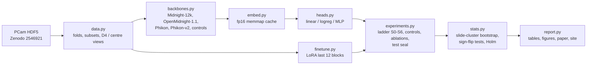

# Better cancer classification: hill-climbing Midnight-12k on PatchCamelyon

This project takes **Midnight-12k** ([Karasikov et al. 2025](https://arxiv.org/abs/2504.05186), [weights](https://huggingface.co/kaiko-ai/midnight)) and tries to improve it, one pre-registered step at a time, on the official **PatchCamelyon (PCam)** lymph-node metastasis benchmark ([Veeling et al. 2018](https://arxiv.org/abs/1806.03962)).
- Midnight-12k is a 1.1B-parameter ViT-g/14 pathology foundation model with an MIT licence and no access gate.
- On PCam's official test split it scores **0.929 balanced accuracy** (BA) under the [kaiko eva](https://github.com/kaiko-ai/eva) protocol: frozen backbone, linear head ([leaderboard CSV](https://github.com/kaiko-ai/eva/blob/main/tools/data/leaderboards/pathology.csv)).
- Every step is chosen on cross-validation over training slides and gated on the validation split. The test split stays **sealed** until the whole procedure is frozen.

> **Status: pre-registered, no results yet.** The hypotheses, metrics, analysis plan and falsification criteria are fixed in [`reports/preregistration.md`](reports/preregistration.md), which was pushed before any embedding, training run or test score existed. This README will gain results tables, figures and a link to the interactive explorer as the stages finish.

## Why
- **Clinical task.** Detecting metastases in sentinel lymph nodes is a routine, labour-intensive step in breast-cancer staging ([Camelyon16](https://jamanetwork.com/journals/jama/fullarticle/2665774)). PCam turns it into a binary patch task: positive if the centre 32×32 px of a 96×96 px patch contains tumour.
- **Where open models stand.** The best published PCam test numbers come from **gated** foundation models (Hibou-L 0.955, UNI2-h 0.950 BA). The best **open, ungated, permissively licensed** model with a published score is Midnight-12k at 0.929.
- **Question.** How much of that gap can cheap, well-evidenced interventions close on one 8 GB laptop GPU? Each intervention is measured with statistics that respect slide-level clustering.

## Method in one paragraph
1. Reproduce the eva baseline exactly: Midnight-12k CLS embedding + linear head, 5 seeds. The gate requires valid BA 0.929 ± 0.01 and embeddings matching eva's.
2. Climb a fixed ladder: embedding pooling (CLS / CLS+mean / extra centre-crop view) → head type (linear / logistic regression / MLP) → D4 test-time augmentation (8 rotations/flips) → fusion with other ungated backbones (OpenMidnight-1.1, Phikon, Phikon-v2) → LoRA fine-tuning of the last 12 transformer blocks.
3. Selection and gating:
   - Each step is selected on slide-grouped 5-fold cross-validation on the training split.
   - It must also not hurt validation BA or AUROC.
   - Rejected steps are reported as negative results.
4. After the ladder is frozen and git-tagged, score every arm once on the sealed test split: baseline, controls, matched baselines, final pipeline and ablations. Also score them on held-out hospitals from Camelyon17-WILDS.
5. Uncertainty: stratified slide-cluster bootstrap CIs and per-slide sign-flip tests with Holm correction.

## Pre-registered hypotheses (summary)
| ID | Claim tested on sealed test |
|---|---|
| H1 | The final pipeline beats the reproduced Midnight-12k baseline by ≥ 1 pt BA |
| H1b | …and beats the best single ungated backbone and a 5-seed probe ensemble (so the gain is not just a backbone swap or ensembling) |
| H4 | LoRA beats a frozen head trained on the same images with the same D4 augmentation |
| H6 | The gain transfers to Camelyon17-WILDS hospitals not used in Camelyon16 |

Controls: shuffled labels, majority class, colour-histogram logistic regression, random-init ViT-g, and DINOv2 ViT-g with natural-image weights. Full details are in the [pre-registration](reports/preregistration.md).

## Architecture


## Setup
Requirements:
- Windows, Linux or WSL with Python 3.12, managed by [uv](https://docs.astral.sh/uv/).
- An NVIDIA GPU. Developed on an RTX 5070 Laptop (8 GB, Blackwell, CUDA 12.8 wheels).
- About 30 GB of disk for data and embedding caches.

```bash
git clone https://github.com/BurnyCoder/better-cancer-classification-with-machine-learning
cd better-cancer-classification-with-machine-learning
cp .env.example .env    # edit DATA_DIR / EMB_DIR / HF_HOME to point at a large disk
uv sync
uv run pytest
```

## Usage
The CLI subcommands are being implemented. Planned interface:

```bash
uv run python main.py download     # PCam from Zenodo, md5-verified
uv run python main.py verify       # leakage checks: slide-disjoint splits, duplicate hashes
uv run python main.py all          # every stage in order (test stays sealed)
uv run python main.py report       # regenerate every table and figure from results/*.json
```

## Data and licences
- **PCam:** CC0 ([README](https://github.com/basveeling/pcam)). Downloaded from [Zenodo 2546921](https://zenodo.org/records/2546921).
  - Note: the GitHub README lists the md5 sums of `valid_x` and `test_x` swapped. The Zenodo API checksums are authoritative and are the ones used here.
- **Camelyon17-WILDS:** CC0 ([WILDS](https://wilds.stanford.edu/datasets/)).
- **Models:**
  - Midnight-12k: MIT.
  - OpenMidnight-1.1: Apache-2.0.
  - DINOv2: Apache-2.0.
  - Phikon / Phikon-v2: Owkin non-commercial licence. They are used for research only, and no derivatives are published.

## Repository layout
```
main.py              CLI wrapper calling each phase
src/pcam_hc/         data, backbones, embedding cache, heads, LoRA, metrics, statistics, experiments, reporting
tests/               pytest suite (TDD)
reports/             pre-registration, per-experiment reports, summary, paper
docs/                usage and design notes
site/                GitHub Pages explorer
```
